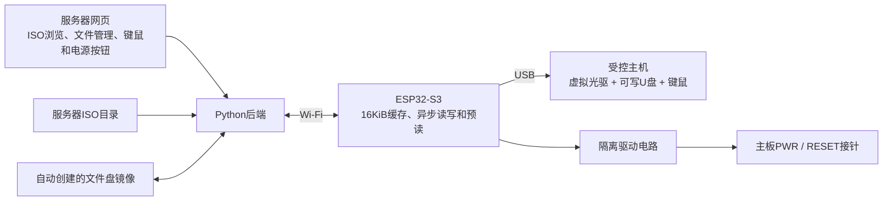
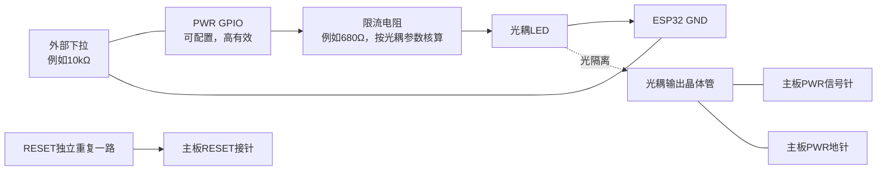

# ESP32-S3 Wi-Fi 键鼠、双逻辑盘与主机按键控制

基于 **ESP-IDF v5.5.2 + TinyUSB**。一根原生 USB 连接受控主机，同时提供：

- Boot HID 键盘和相对鼠标，网页可直接操作。
- **LUN 0：只读 USB 虚拟光驱**，在网页浏览服务器目录并直接选择 ISO。
- **LUN 1：可读写普通 U 盘**，用于 BIOS 等文件的双向传输。
- 参数化配置 GPIO，以脉冲模拟主板 PWR、RESET 按键。

两个盘是同一 USB MSC 接口下的两个逻辑盘，不是单个磁盘的两个分区。**不需要 Ventoy，也不需要手动制作 FAT32/Ventoy 镜像。** 服务首次启动自动创建普通文件盘。ISO 数据会经过 Wi-Fi 和 ESP32-S3 的 USB Full-Speed 链路，16 KiB 缓存及预读可减少等待，但不能突破物理带宽限制。



## 工程内容

| 目录 | 内容 |
|---|---|
| `firmware/` | 双逻辑盘、USB键鼠、缓存、异步网络和GPIO脉冲 |
| `backend/` | ISO目录浏览、不可变ISO快照、文件盘使用权、键鼠及主板按键代理 |
| `tests/` | HTTP、双盘隔离、写入落盘、使用权交接、真实文件系统传输、C缓存测试 |
| `docs/` | 架构、协议、接线与硬件验证 |

## 1. 获取工程与启动服务器

```bash
git clone --recurse-submodules https://github.com/kevin249/esp32-s3-wifi2kbnboot.git
cd esp32-s3-wifi2kbnboot
```

后端推荐运行在 Linux，使用 Python 3.11 或更新版本。无第三方 Python 依赖；**mtools 用于自动创建文件盘，以及服务器侧的文件导入导出**。

```bash
sudo apt-get install python3 mtools
export WIFI_DISK_TOKEN='replace-with-your-random-ascii-token'
python3 -m backend.server \
  --library /实际路径/ISO目录 \
  --data ./data \
  --device-url http://ESP32实际IP \
  --port 8080
```

将令牌替换成随机值，例如使用 `python3 -c "import secrets; print(secrets.token_hex(24))"` 生成。设备固件必须配置同一个令牌。只允许16～240个可见ASCII字符；不要提交真实密码与令牌。

打开 `http://服务器IP:8080/`，输入令牌。网页会列出 `--library` 下的 ISO 和子目录，点击即可挂载。挂载会复制出不可变快照并计算哈希，之后按需读取；大型 ISO 首次选择可能需要等待复制完成，预留额外磁盘空间。旧 ISO 快照暂不自动清理。

默认文件盘容量128 MiB，通过 `--file-disk-mib` 设置32～1024 MiB，仅首次创建时生效；它是 mtools 自动格式化的 FAT 文件盘。重启服务保留已有文件盘，不会重建。上传上限默认128 MiB，可用 `--max-upload-mib` 调整。可选 `--image /实际路径/system.iso` 在首次启动时预选 ISO。

Windows 可以运行读取服务，但新建文件盘与文件管理同样需要可执行的 mtools；建议将完整后端部署在 Linux。服务是单进程示例，请勿运行多个实例同时打开同一个 `data` 目录。HTTP 未配置 TLS，应在可信局域网或既有加密隧道内使用。

## 2. 配置与烧录固件

使用 ESP-IDF v5.5.2 的开发环境：

```bash
cd firmware
idf.py set-target esp32s3
idf.py menuconfig
idf.py build
idf.py -p 实际串口 flash monitor
```

在“Wi-Fi 虚拟启动盘”菜单配置 Wi-Fi、后端地址及令牌。后端地址形如 `http://192.168.1.10:8080`，不要带末尾斜线。Flash容量需符合实际板卡；示例默认8MB。串口日志会打印设备IP，将它填入后端 `--device-url`，网页键鼠与主板按键通过该地址代理发送，浏览器无需跨域访问设备。

TinyUSB 固定到提交 `92c9e65e7ce623300e2afd7678e6adecc027eaa0`。已有工作目录执行 `git submodule update --init`。不要再加入另一份 `esp_tinyusb`，也不要直接升级子模块。

原生 USB OTG 的 **D− 为 GPIO19，D+ 为 GPIO20**，连接受控主机。串口调试使用独立 USB-UART；USB Serial/JTAG 不是本工程的复合设备端口。供电与防回流按开发板电路设计处理。

默认配置不依赖 PSRAM，没有 PSRAM 时使用64 KiB内部缓存。有 PSRAM 的板卡可在 menuconfig 中正确启用，并将缓存块数设置为32，得到512 KiB缓存。`sdkconfig.psram` 仅适合八线 PSRAM 的板卡，其他类型应按实物配置。

设备先连接Wi-Fi、获取容量并领取文件盘使用权，再进行首次USB枚举。网络或后端不可用会推迟首次枚举。工作期间，网络I/O独立运行，不在USB回调中阻塞等待；失败的未缓存读写会返回错误。

## 3. ISO 启动与双向文件传输

### 挂载 ISO

在服务器网页进入“ISO虚拟光驱”，浏览目录并点击 ISO。受控主机将它识别为2048字节扇区的只读光驱。挂载、弹出或切换 ISO 会在读取空闲后重新枚举整个USB复合设备，键鼠与文件盘也会短暂重连。**切换前先在受控主机安全弹出文件盘**，避免尚未提交的主机缓存丢失。

固件实现基础只读MMC命令子集与READ10；不同UEFI、Legacy BIOS及操作系统的光驱命令需求仍需实机验证。不要把“编译成功”当成所有ISO都能启动的保证。

### 服务器向受控主机传文件

1. 在受控主机操作系统中安全弹出普通文件盘。
2. 网页点击“从受控主机取回文件盘”，等待状态变为“服务器使用中”。
3. 选择并上传 BIOS 等文件，写入文件盘根目录。
4. 点击“交还受控主机”，设备清空文件盘缓存并重新挂载；主机即可读取文件。

### 受控主机向服务器传文件

1. 在受控主机上把文件复制到普通U盘，复制完成后安全弹出。
2. 网页取回文件盘，等待设备释放。
3. 点击“查看文件”，再点击文件下载到浏览器。

当前网页管理文件盘根目录中的文件，不提供子目录递归管理。主机端可以正常建立目录；如需导出目录可先在主机端打包成一个文件。

**两端不能同时挂载同一个FAT文件系统。** 服务在主机持有文件盘时返回409拒绝网页文件操作；发出取回请求后，仍允许设备完成已在途I/O，直到设备明确释放。没有按时间自动抢占使用权。设备断电或断网时可能无法完成交接，应恢复连接并在主机安全弹出后重试。不能用“几秒没有读取”代替操作系统的安全弹出。

主机写入采用异步直写：服务器写入、刷新并 `fsync` 成功后，设备才确认USB写入；没有延迟写回缓存。USB主机自身的文件缓存仍需安全弹出。文件盘使用期间不要直接挂载或编辑 `data/transfer.img`。

## 4. 网页键鼠模拟

网页键盘区域支持常用按键、左右修饰键和最多6个普通键，另有 Ctrl+Alt+Delete 按钮。鼠标区域支持相对移动、按钮及滚轮。键盘、鼠标为独立Boot HID接口，Boot Mouse模式使用三字节报告。

失去焦点时网页尝试释放按键；设备也会在默认1.5秒没有新指令时自动释放。网页会周期更新正在保持的按键和鼠标按钮，直接调用API实现长按时也需周期更新。指令队列有界，过期指令丢弃。返回“已提交”代表入队，不代表受控主机已处理。

可直接调用设备80端口，也可以调用后端 `/api/hid/keyboard`、`/api/hid/mouse` 代理：

```bash
curl -X POST http://设备IP/hid/keyboard -H 'Authorization: Bearer TOKEN' -H 'Content-Type: application/json' -d '{"modifiers":0,"keys":[4]}'
curl -X POST http://设备IP/hid/keyboard -H 'Authorization: Bearer TOKEN' -H 'Content-Type: application/json' -d '{"modifiers":0,"keys":[]}'
curl -X POST http://设备IP/hid/mouse -H 'Authorization: Bearer TOKEN' -H 'Content-Type: application/json' -d '{"buttons":0,"x":20,"y":-10,"wheel":0}'
```

键值是USB HID usage，例如4代表A。浏览器或本机系统可能截获某些组合键。此工程没有直接接入One-KVM，需要按其控制接口增加适配。

## 5. PWR / RESET GPIO 设计与参数

两路GPIO默认都是 **-1，禁用**。在 menuconfig 中设置：

| 参数 | 用途 |
|---|---|
| `W2B_PWR_GPIO` | PWR驱动引脚，-1禁用 |
| `W2B_RESET_GPIO` | RESET驱动引脚，-1禁用 |
| `W2B_POWER_ACTIVE_HIGH` | 驱动电路有效电平，默认高有效 |
| `W2B_POWER_OPEN_DRAIN` | GPIO是否开漏，默认关闭，需配合实际电路 |

例如设计时可考虑GPIO4、GPIO5，但必须核对具体板卡占用后再配置，不作为默认接线。程序拒绝复用USB、默认UART、常见模块Flash/PSRAM及部分启动配置引脚，也拒绝PWR与RESET使用同一引脚。

建议每路使用光耦隔离：GPIO经限流电阻驱动光耦LED，光耦输出晶体管并联在主板原有按键两端。原机箱按键可以保留。**主板接针不能直接连接ESP32 GPIO。** GPIO加外部下拉，确保ESP32复位和上电初始化前光耦关闭。



光耦的导通电流、CTR和输出极性应按具体型号确认；上述电阻是设计起点。若采用其他驱动电路，应同步调整有效电平和开漏配置。

网页提供200毫秒短按PWR、200毫秒RESET和5秒长按PWR。接口允许50～8000毫秒脉冲，同一时间只执行一个动作，忙时拒绝新请求。独立任务负责到时释放引脚，不占用USB任务。

```bash
curl -X POST http://设备IP/control/power -H 'Authorization: Bearer TOKEN' -H 'Content-Type: application/json' -d '{"button":"pwr","duration_ms":200}'
curl -X POST http://设备IP/control/power -H 'Authorization: Bearer TOKEN' -H 'Content-Type: application/json' -d '{"button":"reset","duration_ms":200}'
```

PWR只是模拟按键，不代表一定开机或关机；长按行为由主板决定。没有接入主机电源状态检测，网页不显示推断出的开关机状态。

## 6. 验证与限制

```bash
python3 -m unittest discover -s tests -v
node --test tests/test_ui.js
gcc -std=c11 -Wall -Wextra -Werror -Ifirmware/main tests/test_cache.c firmware/main/block_cache.c -o test-cache
./test-cache
```

GitHub Actions执行真实mtools文件传输测试、C缓存内存检查和ESP-IDF构建。当前开发环境未连接目标ESP32-S3及主板，USB双盘识别、各种ISO启动、GPIO电平与脉冲需要实机验证。参见 [架构与协议](docs/架构与协议.md) 和 [验证说明](docs/验证说明.md)。

上游参考：[TinyUSB固定源码](https://github.com/hathach/tinyusb/tree/92c9e65e7ce623300e2afd7678e6adecc027eaa0)、[ESP-IDF v5.5.2](https://github.com/espressif/esp-idf/tree/v5.5.2)、[mtools](https://www.gnu.org/software/mtools/)。
