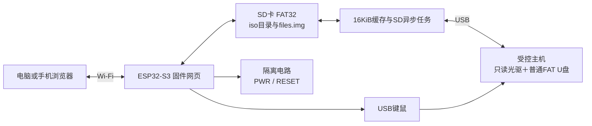
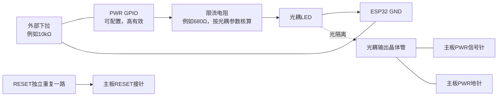
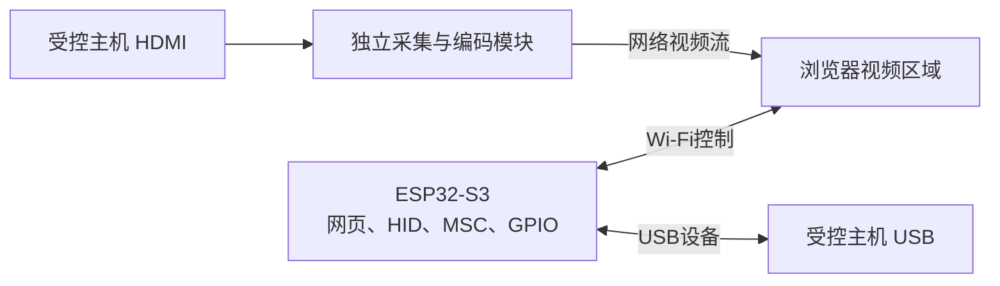

# ESP32-S3 独立 Wi-Fi KVM 控制与 BIOS 文件盘

按 BIOS 可读优先设计：**普通 FAT U 盘用于 BIOS 文件，ISO 保留只读虚拟光驱**。网页、文件管理、键鼠、PWR/RESET、SD 卡读写全部运行在 ESP32-S3 固件内，不需要 Python 后端、One-KVM、外部服务器或 MTP。

不提供两端同时挂载 FAT 的实时共享。即使写不同文件，仍会共同修改 FAT 表与目录，因此网页和受控主机必须交接使用文件盘。双向传输仍保留：网页上传后交还主机；主机写入后安全弹出，再取回到网页下载。



## 1. 硬件与 SD 卡

- ESP32-S3，参考 ESP-IDF **v5.5.2**，默认8MB Flash；按实际板卡修改容量。
- FAT32 格式的 SD 卡。**现有 SD 卡挂载失败不会被自动格式化**，exFAT 需事先备份并改成 FAT32。
- 使用1位 SDMMC：默认 CLK=GPIO14、CMD=GPIO15、D0=GPIO2，可在 menuconfig 修改。
- CMD、D0和必要的SD数据脚需按SD卡/模块电路配置外部上拉，不能只依赖芯片内部弱上拉；信号使用3.3V。
- 原生USB：D−=GPIO19、D+=GPIO20，连接受控主机。日志使用独立USB-UART。
- PWR/RESET默认禁用，需要额外光耦或合适的开漏驱动电路。

请先核对开发板原理图，SD引脚不能与USB、Flash/PSRAM或其他外设冲突。供电与防回流按板卡设计处理。

固件首次启动会在SD根目录自动创建 `files.img`，默认128MiB，可配置32～1024MiB。它是带 **MBR 分区表的 FAT16 镜像**，由ESP32在USB侧模拟普通U盘。初始化需要写入整个镜像，首次上电网页可能需要等待；修改配置容量不会覆盖已有镜像。

```text
SD卡内容：iso目录保存ISO或分卷；files.img保存普通U盘内容；files.creating是首次创建时的临时文件。
```

## 2. 编译与独立运行

```bash
git clone --recurse-submodules https://github.com/kevin249/esp32-s3-wifi2kbnboot.git
cd esp32-s3-wifi2kbnboot/firmware
idf.py set-target esp32s3
idf.py menuconfig
idf.py build
idf.py -p 实际串口 flash monitor
```

在“独立Wi-Fi虚拟启动盘”设置令牌、网络、SD接线和主板GPIO。TinyUSB固定提交 `92c9e65e7ce623300e2afd7678e6adecc027eaa0`，已有工作目录执行 `git submodule update --init`，不要再加入另一套 `esp_tinyusb`。

默认由ESP32提供热点：名称 `ESP32-KVM`，示例密码 `change-me-12345`；连接后打开 **http://192.168.4.1/**。令牌示例值为 `change-this-token-before-use`。**实际使用前必须修改热点密码和令牌**，令牌为16～240个可见ASCII字符。也可以启用STA选项连接现有Wi-Fi，设备IP从串口或路由器查看。

控制网页直接嵌入固件，不需要安装运行服务。HTTP适合可信局域网；没有默认TLS或公网访问功能。

默认没有PSRAM时使用64KiB缓存。配有PSRAM的板卡可按实际类型启用，再把缓存块数设成32得到512KiB缓存；`sdkconfig.psram`仅适用于八线PSRAM。所有数据放在SD卡，PSRAM只用于缓存。

## 3. BIOS 文件传输与 ISO 挂载

### 普通文件盘

正常启动时文件盘交给受控主机。网页操作步骤：

1. 在受控主机的操作系统中安全弹出文件盘。若主机停留在BIOS，先确认没有读取或刷写操作进行。
2. 网页点击“从受控主机取回文件盘”，等待状态变为网页端使用。
3. 上传、下载或删除根目录文件，按厂商要求给BIOS文件命名。
4. 点击“交还受控主机”，USB重新连接后由BIOS或操作系统读取文件。

反向传输：受控主机把文件复制到U盘，安全弹出后网页取回，再下载。当前网页管理根目录文件；主机端可以创建目录，需要导出目录时可先打包成单个文件。

取回/交还使用同一文件盘镜像，接收USB写入并同步SD成功后才确认写入。主机自身的缓存仍需安全弹出。空闲时间只表示暂时没有I/O，不代表刷写、复制或安装完成。正在刷BIOS时不要取回文件盘或切换ISO。

### 只读虚拟光驱

先取回文件盘，再在网页ISO区域选择或上传ISO并挂载。ISO目录是SD卡上的 `iso`；也可以关机后将ISO直接复制到SD卡。已挂载的ISO及分卷禁止外部修改，删除前必须弹出ISO。

ISO为2048字节逻辑扇区，普通文件盘为512字节扇区。正常构建中ISO是LUN0，文件盘是LUN1；它们是两个逻辑盘，不是同一磁盘的两个分区。ISO切换、文件盘交接会短暂断开整个USB设备，包括键鼠。

FAT32单文件小于4GiB。大ISO可使用随项目提供的Node.js工具分卷；Node.js只用于电脑上预处理，不是设备的运行依赖：

```bash
node tools/split_iso.js 原始系统.iso 输出目录
```

工具生成 `系统.iso.000`、`.001` 等1GiB分卷，最多32卷。把**全部分卷**放到SD的iso目录，或按顺序通过网页上传；网页只选择 `.iso.000`。固件按需拼接成完整只读光驱，受控主机看不到分卷。普通单文件ISO可以直接挂载。不要在挂载期间添加、删除或修改分卷；分卷应来自同一个原始ISO。

默认网页单次上传上限1GiB，完整大ISO建议分卷或离线复制到SD。上传不覆盖已有同名文件，需先删除旧文件。上传/下载使用独立任务，控制网页、键鼠和主板按键服务可以继续处理请求。

## 4. BIOS 兼容构建与键鼠

正常构建提供光驱、普通U盘、独立Boot键盘和Boot鼠标。部分主板固件不扫描第二个LUN或不接受复合设备，因此另外提供**BIOS纯U盘构建**：只暴露LUN0普通U盘，关闭USB光驱和键鼠；网页与PWR/RESET保留。

```bash
idf.py -B build-bios -D IDF_TARGET=esp32s3 -D SDKCONFIG=sdkconfig.bios.ci -D SDKCONFIG_DEFAULTS="sdkconfig.defaults;sdkconfig.bios" build
idf.py -B build-bios -p 实际串口 flash
```

也可以在menuconfig启用“BIOS兼容构建”。两种构建使用同一个files.img，不删除文件。兼容构建改变USB产品ID，避免桌面系统混用旧设备配置。

MBR、FAT16、根目录文件和单LUN模式提高BIOS兼容性，**无法在没有目标主板实测的情况下保证所有BIOS都识别**。部分厂商刷写工具有特定文件名、介质类型或USB口要求，请按厂商说明验证。

正常构建的网页支持键盘、修饰键、Ctrl+Alt+Delete和相对鼠标。Boot Mouse使用三字节报告。失去焦点时网页尝试释放，设备也在默认1.5秒无更新后自动释放；长按由网页周期更新。兼容构建不提供USB键鼠，接口会明确拒绝指令。

所有接口均直接访问ESP32，无代理或外部后端：

```bash
curl -X POST http://设备IP/api/hid/keyboard -H 'Authorization: Bearer TOKEN' -H 'Content-Type: application/json' -d '{"modifiers":0,"keys":[4]}'
curl -X POST http://设备IP/api/hid/keyboard -H 'Authorization: Bearer TOKEN' -H 'Content-Type: application/json' -d '{"modifiers":0,"keys":[]}'
```

## 5. PWR / RESET GPIO 设计与参数

两路GPIO默认都是 **-1，禁用**。在 menuconfig 中设置：

| 参数 | 用途 |
|---|---|
| `W2B_PWR_GPIO` | PWR驱动引脚，-1禁用 |
| `W2B_RESET_GPIO` | RESET驱动引脚，-1禁用 |
| `W2B_POWER_ACTIVE_HIGH` | 驱动电路有效电平，默认高有效 |
| `W2B_POWER_OPEN_DRAIN` | GPIO是否开漏，默认关闭，需配合实际电路 |

例如设计时可考虑GPIO4、GPIO5，但必须核对具体板卡占用后再配置，不作为默认接线。程序拒绝复用USB、默认UART、常见模块Flash/PSRAM及部分启动配置引脚，也拒绝PWR与RESET使用同一引脚。

建议每路使用光耦隔离：GPIO经限流电阻驱动光耦LED，光耦输出晶体管并联在主板原有按键两端。原机箱按键可以保留。**主板接针不能直接连接ESP32 GPIO。** GPIO加外部下拉，确保ESP32复位和上电初始化前光耦关闭。



光耦的导通电流、CTR和输出极性应按具体型号确认；上述电阻是设计起点。若采用其他驱动电路，应同步调整有效电平和开漏配置。

网页提供200毫秒短按PWR、200毫秒RESET和5秒长按PWR。接口允许50～8000毫秒脉冲，同一时间只执行一个动作，忙时拒绝新请求。独立任务负责到时释放引脚，不占用USB任务。

```bash
curl -X POST http://设备IP/api/control/power -H 'Authorization: Bearer TOKEN' -H 'Content-Type: application/json' -d '{"button":"pwr","duration_ms":200}'
curl -X POST http://设备IP/api/control/power -H 'Authorization: Bearer TOKEN' -H 'Content-Type: application/json' -d '{"button":"reset","duration_ms":200}'
```

PWR只是模拟按键，不代表一定开机或关机；长按行为由主板决定。没有接入主机电源状态检测，网页不显示推断出的开关机状态。

## 6. 如果视频采集也放到 ESP32 上

**当前固件没有实现视频采集，网页没有承诺可直接显示HDMI画面。** ESP32-S3原生只有一个可用于这些功能的USB OTG控制器；它正作为Device连接受控主机，不能同时再作为Host接USB采集卡。加USB集线器或外接PHY不会增加一个独立OTG控制器。

可考虑三种硬件方向：

| 方向 | 做法与限制 |
|---|---|
| 保留S3控制，再增加独立视频模块 | 原S3做HID/MSC/GPIO；另一模块接采集卡、处理视频并提供网络视频流。适合继续使用普通HDMI-UVC采集卡。 |
| 再增加一颗S3做低速UVC主机 | 仅支持兼容USB Full-Speed且输出MJPEG的特定设备，低分辨率低帧率场景；普通USB2.0高速HDMI采集卡未必能工作。需核对描述符与带宽。 |
| 使用独立HDMI接收与JPEG编码硬件 | 经DVP或其他合适接口把已压缩帧送到S3，再由Wi-Fi提供MJPEG；需要额外硬件及驱动，不是把HDMI线接到GPIO。 |

如果要把普通高清HDMI采集与USB设备控制合并到单板，适合评估具有独立USB主机/设备通路和更强视频处理能力的平台；仍需Wi-Fi、内存、采集兼容性和编码能力的完整设计。S3没有能直接承担常规高清H.264编码的硬件，不能承诺高清低延迟KVM效果。



官方参考：[ESP32-S3 USB设备能力](https://docs.espressif.com/projects/esp-usb/en/latest/esp32s3/usb_device.html)、[乐鑫USB视频流组件与Full-Speed设备要求](https://docs.espressif.com/projects/esp-iot-solution/en/latest/usb/usb_host/usb_stream.html)。后一个旧组件已停止维护，实际开发应按其说明采用当前的usb_host_uvc组件；这里只引用硬件兼容条件。

## 7. 检查与交付范围

GitHub Actions使用ESP-IDF v5.5.2编译正常版和BIOS纯U盘版；还把实际生产sd_media.c与同版本FatFs一起编译到原生测试中，验证MBR/FAT16、中文BIOS文件、双向交接、ISO读取与边界。页面事件、C缓存和大ISO分卷逻辑也有自动测试。

```bash
node --test tests/test_ui.js
gcc -std=c11 -Wall -Wextra -Werror -Ifirmware/main tests/test_cache.c firmware/main/block_cache.c -o test-cache
gcc -std=c11 -Wall -Wextra -Werror -Ifirmware/main tests/test_media_rules.c firmware/main/media_rules.c -o test-rules
```

当前环境没有连接ESP32-S3、SD卡或目标主板，SD接线、电气、实际USB传输、BIOS识别、ISO启动和主板按键时序均需实机验证。没有把编译或文件系统测试当成硬件验收。详细结构与测试清单见 [架构与协议](docs/架构与协议.md) 和 [验证说明](docs/验证说明.md)。
