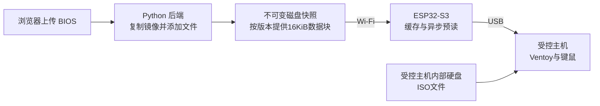

# ESP32-S3 Wi-Fi 键鼠与虚拟启动盘示例

基于 ESP-IDF 与 TinyUSB，将 ESP32-S3 模拟成 USB 键盘、鼠标和只读 U 盘。U 盘内容由 Wi-Fi 后端提供，使用 Ventoy 引导，再启动受控主机内部硬盘上预先存放的 ISO。

支持 16 KiB 分块缓存、异步磁盘读取、连续访问预读，以及在线上传 BIOS 等文件并刷新虚拟盘。**在线上传采用新快照发布，主机刷新后看到新文件；不支持在主机已挂载的文件系统下面直接修改扇区。**

这是可构建的参考工程，不能把软件测试通过理解为已验证所有主板的 UEFI、Legacy BIOS、Secure Boot 或刷写工具兼容性。硬件实测清单见 [验证说明](docs/验证说明.md)。



## 工程内容

| 目录 | 用途 |
|---|---|
| `firmware/` | ESP-IDF 工程、TinyUSB 适配、MSC 与 HID |
| `backend/` | Python 标准库 HTTP 服务及中文管理页面 |
| `tools/prepare_image.sh` | Linux 上创建具有 FAT32 数据分区的 Ventoy 镜像 |
| `tests/` | 快照隔离、HTTP、FAT32 写入与真实 C 缓存测试 |
| `docs/` | 架构、协议、运行限制与硬件验证步骤 |

## 1. 获取工程

```bash
git clone --recurse-submodules https://github.com/kevin249/esp32-s3-wifi2kbnboot.git
cd esp32-s3-wifi2kbnboot
```

已有工作目录执行 `git submodule update --init`。TinyUSB 固定为提交 `92c9e65e7ce623300e2afd7678e6adecc027eaa0`，不要直接替换为 ESP-IDF 自带的另一版本。

## 2. 准备完整 Ventoy 磁盘镜像

需要的是包含分区表的完整磁盘镜像，不能使用 Ventoy 安装包、单个 EFI 文件或系统 ISO 代替。已有镜像可以直接读取；在线上传要求其**第一分区为 FAT32**。Ventoy 默认 exFAT 第一分区可以引导，但本示例不通过 mtools 修改 exFAT。

在 Linux 上安装依赖，并下载、解压官方 Ventoy Linux 安装包后：

```bash
sudo apt-get install mtools dosfstools util-linux parted udev
sudo bash tools/prepare_image.sh /实际路径/ventoy/Ventoy2Disk.sh ./ventoy.img 256
sudo chown "$(id -u):$(id -g)" ./ventoy.img
```

脚本只格式化它自己创建的 loop 设备中的第一分区，拒绝覆盖已有镜像。256 MiB 用于引导与 BIOS 文件；大型 ISO 放在受控主机内部硬盘。数据分区改为 FAT32 不影响 Ventoy 的启动分区。FAT32 单文件需小于 4 GiB。

也可以在普通 U 盘安装 Ventoy、将数据分区改成 FAT32，再用磁盘工具导出整个 U 盘镜像。不要把 `data/images/` 中已经发布的镜像挂载为可写或直接编辑。

## 3. 启动 Wi-Fi 后端

Python 3.11 或更新版本，无第三方 Python 依赖。Linux 后端支持完整功能；Windows 可以运行读取服务，上传功能还需可执行的 mtools，推荐通过 Linux 主机运行后端。

Linux：

```bash
export WIFI_DISK_TOKEN='replace-with-your-random-ascii-token'
python -m backend.server --image ./ventoy.img --data ./data --port 8080
```

PowerShell：

```powershell
$env:WIFI_DISK_TOKEN = 'replace-with-your-random-ascii-token'
python -m backend.server --image .\ventoy.img --data .\data --port 8080
```

令牌用于 HTTP 头，请使用 ASCII 字符；上面是占位值，实际应替换，例如用 `python -c "import secrets; print(secrets.token_hex(24))"` 生成。首次导入后，重复启动从 `data/current.json` 恢复当前版本，不会重复导入 `--image`。

打开 `http://后端IP:8080/`，输入令牌后可以查看版本、上传文件和请求刷新。默认上传上限 128 MiB，可用 `--max-upload-mib` 调整。镜像复制和计算哈希需要时间与额外空间，每个版本目前保留完整副本；**示例没有自动清理旧版本**。

服务使用明文 HTTP，适合可信局域网或已有加密隧道内使用，不要直接暴露到公网。没有登录、TLS、速率限制或多人协作管理功能。

## 4. 配置并烧录 ESP32-S3

参考工具链：**ESP-IDF v5.5.2**。使用 ESP-IDF 自己的环境执行：

```bash
cd firmware
idf.py set-target esp32s3
idf.py menuconfig
idf.py build
idf.py -p 实际串口 flash monitor
```

在“Wi-Fi 虚拟启动盘”菜单设置 Wi-Fi 名称、密码、后端地址和同一个 ASCII 令牌。后端地址例如 `http://192.168.1.10:8080`，不要带末尾斜线。配置中包含密码，不应提交生成的 `sdkconfig`。

默认不依赖 PSRAM，请求8个缓存块但在没有 PSRAM 时退回4个块，即64 KiB。配有八线 PSRAM 的开发板可以使用：

```bash
idf.py -D SDKCONFIG_DEFAULTS="sdkconfig.defaults;sdkconfig.psram" reconfigure
idf.py menuconfig
```

确认板卡真实的 Flash 容量、PSRAM 类型和引脚配置后，将缓存块数改为32，即512 KiB。其他 PSRAM 类型请在 menuconfig 中选择，不要盲用八线配置。

原生 USB OTG 的 D− 为 GPIO19、D+ 为 GPIO20，连接受控主机。串口调试使用独立 USB-UART；不要把 USB Serial/JTAG 接口当成固件的复合设备接口。开发板供电方式应按其硬件设计选择，避免两个电源互相供电。

设备先连接 Wi-Fi 并获取镜像信息，再枚举 USB，保证第一次枚举时磁盘容量正确。Wi-Fi 或服务不可用会延迟首次枚举。工作时 Wi-Fi 故障不会阻塞 HID 任务，未缓存磁盘读取会按超时失败。

## 5. 启动本地 ISO 和添加 BIOS 文件

1. 将 ISO 提前放入受控主机能够在启动阶段读取的磁盘分区。
2. 从 ESP32-S3 虚拟 U 盘启动，Ventoy 菜单按 F2 浏览本地 ISO。
3. 如需固定菜单，为各 ISO 使用官方 VentoyVlnk 工具生成 `.vlnk.iso` 文件，再通过后端上传；本示例上传文件统一存放在虚拟盘 `/BIOS/` 目录，也可以放置 vlnk 文件。
4. 上传 BIOS 后，默认只发布新版本。结束当前文件读取/启动操作后，点击“刷新虚拟盘”；也可主动勾选“上传成功后刷新”。
5. ESP32-S3 检测到刷新请求，等读取空闲后断开整个 USB 设备约1秒，清空旧缓存，再连接新版本。**键鼠也会短暂重连**。

刷新请求一般在2秒轮询周期内被发现，随后还有默认3秒读取空闲等待和1秒断连；持续读取会延迟发现或切换，镜像发布本身也需要复制时间。**不能保证上传后立即出现在当前 Ventoy 菜单**，可能要退出菜单、重进或重启。

刷 BIOS 期间不要刷新。读取空闲只表示暂时没有 USB READ10，不能判断刷写或安装是否结束。部分主板的固件刷写工具不识别复合 USB 设备或只读介质，必须用目标设备验证。受控主机不能向虚拟盘写文件；“添加文件”在后端完成。

## 6. 远程键鼠接口

串口日志输出 ESP32-S3 的 IP。向**设备 IP 的80端口**发送，磁盘服务则在后端8080端口。键值使用 USB HID usage，不是 ASCII。

```bash
# 按下 A，再立即释放；请把 TOKEN 和设备地址替换成实际值。
curl -X POST http://设备IP/hid/keyboard -H 'Authorization: Bearer TOKEN' -H 'Content-Type: application/json' -d '{"modifiers":0,"keys":[4]}'
curl -X POST http://设备IP/hid/keyboard -H 'Authorization: Bearer TOKEN' -H 'Content-Type: application/json' -d '{"modifiers":0,"keys":[]}'
curl -X POST http://设备IP/hid/mouse -H 'Authorization: Bearer TOKEN' -H 'Content-Type: application/json' -d '{"buttons":0,"x":20,"y":-10,"wheel":0}'
```

接口返回202代表已入队，不保证受控主机已处理。队列有界，过期指令丢弃；默认1.5秒没有新指令时自动释放按键/鼠标按钮。长按需要周期更新。键盘和鼠标使用独立的 Boot HID 接口，鼠标是相对模式。One-KVM 的控制 API 需要另写适配，此工程没有修改或直接接入 One-KVM。

## 7. 测试

```bash
python -m unittest discover -s tests -v
gcc -std=c11 -Wall -Wextra -Werror -Ifirmware/main tests/test_cache.c firmware/main/block_cache.c -o test-cache
./test-cache
```

有 mtools 和 dosfstools 时会运行真正的 FAT32 写入及读回测试；没有时该项明确跳过。GitHub Actions 同时执行后端测试、带内存检查的缓存测试和 ESP-IDF 编译。详细接口和取消机制见 [架构与协议](docs/架构与协议.md)。

参考：[Ventoy 本地磁盘启动](https://www.ventoy.net/cn/doc_vlnk.html)、[Ventoy 分区布局](https://www.ventoy.net/cn/doc_disk_layout.html)、[TinyUSB 异步 MSC 接口](https://github.com/hathach/tinyusb/blob/92c9e65e7ce623300e2afd7678e6adecc027eaa0/src/class/msc/msc_device.h)、[ESP-IDF](https://github.com/espressif/esp-idf/tree/v5.5.2)。
