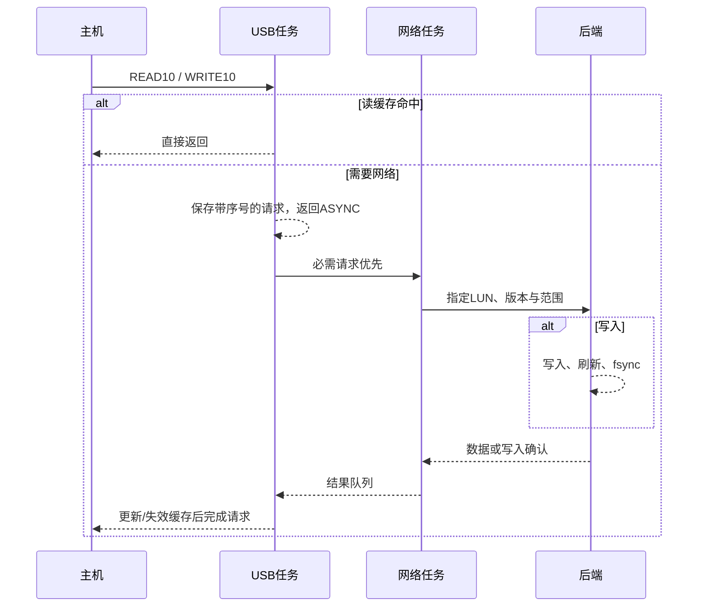
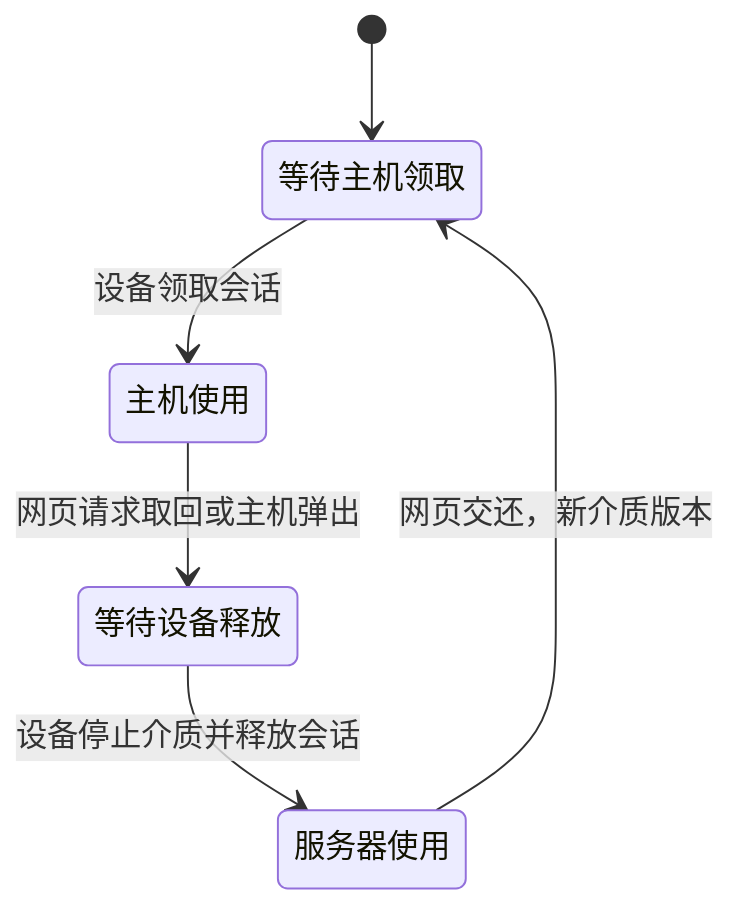

# 架构与协议

## 双逻辑盘

同一USB MSC接口提供两个LUN，TinyUSB当前版本的 `tud_msc_get_maxlun_cb` 返回数量2，由驱动减1得到最大编号1。LUN0是2048字节扇区的只读光驱，LUN1是512字节扇区的可写磁盘。HID键盘和鼠标使用独立接口，主板按键通过GPIO实现。

两盘共用16 KiB缓存，地址键加入LUN编号，防止相同扇区位置串盘。64位地址计算支持较大的ISO。跨缓存块读取返回当前块的有效部分，由TinyUSB继续请求剩余数据。

## USB与网络任务

缓存及待完成USB请求只由USB任务访问。网络任务只访问HTTP客户端及中转区。任务和结果队列各一项，USB消费结果后才提交下一项网络操作。READ和WRITE都异步完成；写入在网络任务开始前复制到独立中转区，网络任务不会直接访问USB缓冲区。

每个必需请求有单调递增序号。重置取消待完成请求；旧写入完成结果不得完成后来的新请求。旧同版本读取可以填缓存，旧写入结果也会使受影响缓存失效。网络超时返回错误，不伪造零数据。主机确认写入之前后端已调用fsync，但主机自己的文件系统缓存仍需安全弹出。

连续读取至少推进两次才启动预读，默认窗口32 KiB；跳转后收缩。预读优先级低于必需读写。缓存按LRU管理，未消费预读块优先淘汰。没有持久化热点学习或延迟写回缓存。

## TinyUSB适配

构建时生成适配后的MSC源文件，上游子模块保持原样。总线/配置重置及BOT重置通知应用取消挂起I/O，BOT重置清除异步标志。异步完成在USB所有者任务内立即处理，避免旧延迟完成事件跨越重置而误完成新请求。

因此 `tud_msc_async_io_done` 在本工程只能由USB任务调用，禁止在网络任务和ISR中调用。主应用使用WHOLE_ARCHIVE保留没有应用侧直接引用的USB描述符及回调。

光驱包含INQUIRY、READ10及基础TOC、配置、介质信息、MODE SENSE(10)和事件查询子集，不是完整MMC光驱实现。READ12、READ CD及厂商命令未实现。需要它们的主机可能无法启动，应按实机抓包扩展，不能承诺所有ISO与主板通用。

## 文件盘使用权

所有文件盘扇区I/O需要私有会话及当前介质版本。ISO版本是完整文件SHA-256，文件盘版本是随机介质代号，不是可变磁盘内容的哈希。请求交接后，已有会话仍可完成在途I/O；服务器文件工具必须等owner清空且mode为server才可使用。

使用权没有自动超时或强制抢占，以免离线主机仍持有旧文件系统缓存。设备明确断开USB后才提交释放会话。交还文件盘会改变版本、清空设备缓存并重新枚举。上传写盘失败时保持服务器使用状态，应检查文件系统后再交还。

此互斥只约束本服务；操作者不能绕过服务直接挂载 `transfer.img`。没有跨进程锁、分布式仲裁或异常断电自动修复。安全弹出由操作者在受控主机完成，读写空闲阈值不能证明主机已刷新文件系统。

## 接口

除网页外均要求 `Authorization: Bearer <令牌>`。文件盘块I/O另需 `X-Session`。ISO目录被限制在 `--library` 内，禁止路径逃逸，目录列表不包含符号链接。

| 接口 | 作用 |
|---|---|
| `GET /api/manifest` | 两盘容量、版本、介质状态、刷新序号 |
| `GET /api/library?path=相对路径` | 浏览服务器ISO目录 |
| `POST /api/mount`，`{"path":"系统.iso"}` | 发布并请求挂载ISO |
| `POST /api/eject` | 弹出ISO，文件盘内容保留 |
| `GET /api/block?lun=0或1&version=...&offset=...&length=...` | 扇区读取 |
| `POST /api/transfer/claim`，`{"device":"设备标识"}` | 领取文件盘会话 |
| `POST /api/transfer/write?version=...&offset=...` | 原始扇区写入 |
| `POST /api/transfer/take` | 请求设备交还文件盘 |
| `POST /api/transfer/release` | 设备释放会话 |
| `POST /api/transfer/attach` | 服务器交还文件盘 |
| `GET /api/transfer/files` | 根目录文件列表 |
| `POST /api/transfer/upload?name=BIOS.bin` | 原始文件上传 |
| `GET /api/transfer/download?name=文件名` | 文件下载 |
| `POST /api/hid/keyboard`、`/api/hid/mouse` | 代理设备键鼠指令 |
| `POST /api/control/power` | 代理设备PWR/RESET脉冲 |

块I/O按512字节对齐，每次不超过64 KiB。固件读缓存块16 KiB，USB传输缓冲8 KiB。读取核对长度、版本和偏移；写入核对已写字节数、版本与偏移。缓存尾块只取实际存在的字节。

后台每约2秒在网络有空时获取manifest，持续必需I/O可以延迟轮询。默认等待3秒I/O空闲后断开USB，最短断连约1秒。领取/释放会话还需网络请求，因此没有严格实时完成保证。首次ISO导入包括复制与哈希时间。

## 主板按键

PWR/RESET引脚和有效电平在固件配置；两路默认禁用。独立任务输出50～8000毫秒脉冲，执行中拒绝新脉冲。初始化先设置无效输出值再启用输出方向；硬件外部电阻负责复位和启动前的确定电平。隔离电路设计见README。

没有接入电源指示灯检测，不推断主机状态。CPU卡死、供电异常或错误外部电路仍可能影响脉冲，不把软件定时器当成硬件安全定时器。
