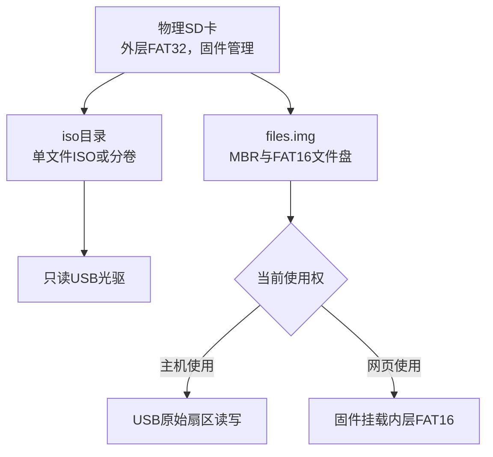

# 独立固件架构与协议

## 运行结构

ESP32-S3同时运行Wi-Fi网页、文件管理、USB设备栈、SD卡I/O和主板按键任务。不需要Python服务或One-KVM。按照最终需求，不采用MTP或实时双端写入FAT。

正常USB配置为两个独立Boot HID接口和一个双LUN MSC接口：LUN0为2048字节扇区只读光驱，LUN1为512字节扇区普通U盘。BIOS兼容构建仅保留一个MSC接口，LUN0映射普通文件盘。

## 两层文件系统

SD卡外层FAT32由固件管理，保存iso目录和files.img。普通U盘的MBR、FAT16、目录及数据都在files.img内部。USB侧只导出内层镜像，不导出整张SD卡。

网页取回文件盘后，固件把files.img注册成另一个FatFs磁盘并挂载到/files。交还主机时先卸载内层FAT卷并同步外层文件，再通过USB暴露原始扇区。主机使用期间网页不挂载同一内层卷。

文件操作使用全局SD互斥锁；嵌套文件盘驱动通过外层FIL访问镜像。FatFs按卷的锁保护跨卷操作，底层镜像始终只有一个FIL，不允许旁路打开或修改。原生集成测试直接编译生产sd_media.c并使用同版本FatFs验证这条路径。

## 异步与缓存

USB回调命中缓存时立即复制，未命中或写入时返回ASYNC，SD任务在独立16KiB中转区完成读写，结果回到USB任务后才调用完成接口。网络线程或SD线程不直接调用TinyUSB，不持有USB缓冲区指针。

每个请求有独立序号；重置取消挂起请求，旧写入结果不得完成后来请求。写入成功或失败后都使重叠缓存失效。读数据按LUN编号隔离缓存键，预读优先级低于主机必需I/O。连续访问至少推进两次才开始预读，随机跳转收缩窗口。

USB写入必须在f_write和f_sync成功后确认，无延迟写回缓存。主机操作系统自己的缓存仍必须安全弹出。超时返回读取/写入错误，不用全零数据冒充成功。

TinyUSB固定版本的受控适配仍保留：总线/BOT重置通知应用取消请求，异步完成仅在USB任务同步处理，防止延迟完成事件跨过重置。构建时生成适配文件，上游子模块不修改。

## 介质控制

取回、交还、选择和弹出ISO由队列交给USB任务。USB任务等待没有挂起I/O、SD任务空闲及默认3秒I/O空闲，断开USB后交给SD任务完成卸载/挂载，清缓存，至少1秒后重新连接。

ISO切换前要求文件盘已经取回，避免让仍挂载的可写卷突然消失。排队时与实际执行时都检查使用权；重复交还请求不会额外断开USB。网页有文件传输时，交接失败并保持原状态，用户可在传输结束后重试。

空闲阈值不是安全弹出的替代品。BIOS中也需先停止读盘、刷写或安装。异常断电与错误的主机行为仍可能损坏文件盘，需要离线检查或恢复，不自动清空已有SD卡。

## HTTP接口

网页直接嵌入Flash。除根页面外，所有接口要求Authorization Bearer令牌。API直接由设备处理，没有控制代理。

| 接口 | 功能 |
|---|---|
| GET /api/manifest | SD、镜像、文件盘使用权、交接及最后错误 |
| GET /api/library | SD卡iso目录的ISO和首分卷列表 |
| POST /api/iso/upload?name=文件名 | 向SD卡iso目录上传 |
| POST /api/iso/delete?name=文件名 | 删除ISO或分卷，需先弹出ISO |
| POST /api/mount | JSON中的path选择ISO名称 |
| POST /api/eject | 弹出ISO |
| POST /api/transfer/take | 取回文件盘 |
| POST /api/transfer/attach | 交还主机 |
| GET /api/transfer/files | 内层文件盘根目录列表 |
| POST /api/transfer/upload?name=文件名 | 上传根目录文件 |
| GET /api/transfer/download?name=文件名 | 下载根目录文件 |
| POST /api/transfer/delete?name=文件名 | 删除根目录文件 |
| POST /api/hid/keyboard | 键盘报告 |
| POST /api/hid/mouse | 相对鼠标报告 |
| POST /api/control/power | PWR或RESET脉冲 |

上传/下载使用ESP-IDF异步HTTP处理，最多同时2项；每个SD读写片段短时间持锁，不让HTTP服务主任务被整文件传输阻塞。临时文件以隐藏名称写入，写入、刷新和关闭完成后再重命名发布；同名目标不覆盖。

单次上传上限默认1GiB；文件名需为普通名称，不接受路径。当前网页管理根目录文件，最多列出256项，不提供递归目录管理。返回202表示请求入队，必须结合后续manifest确认实际结果。

## 大ISO与存储限制

ESP-IDF v5.5.2的FatFs配置不支持exFAT。SD卡需使用FAT32；单文件小于4GiB。普通ISO直接用FatFs FIL读取，避免32位POSIX有符号偏移限制；大ISO分成最多32个1GiB分卷，由设备按逻辑偏移拼接。缺卷、非末卷大小错误或总长度不按2048字节对齐时拒绝挂载。

分卷仅解决FAT32单文件限制，不保证ISO来源完整性；用户应核对原始ISO和分卷来源。固件没有提供签名验证、自动下载、录像或视频采集。
