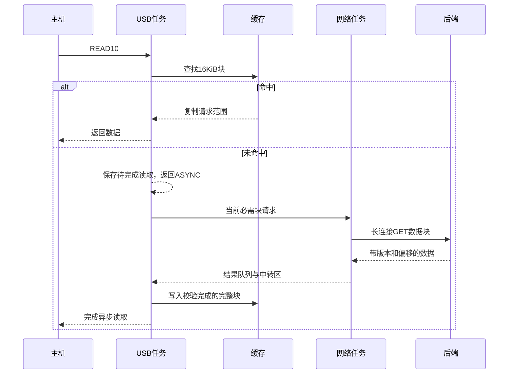
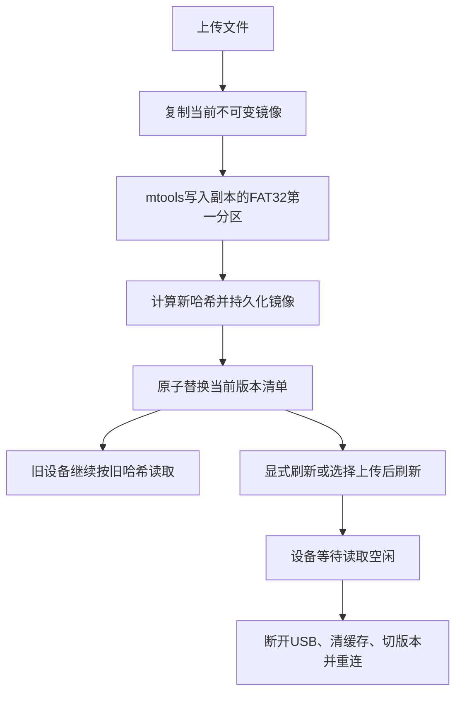

# 架构与协议

## 线程及内存所有权



缓存、待完成 USB 读取、镜像切换状态仅由 USB 任务访问。网络线程独占 HTTP 客户端及16 KiB中转区。任务队列和结果队列各1项；USB 消费结果、复制缓存后才允许下一项网络任务覆盖中转区。

缓存命中立即复制；跨块读取只返回当前块能提供的部分，由 TinyUSB 继续回调读取剩余部分。地址按64位计算，不能将 `lba * 512` 在32位范围内先计算后转换。

连续检测按逻辑请求末尾地址进行，至少出现两次连续访问才扩大预读窗口。默认窗口2块。随机跳转清除后续预读计划；已在途预读不能强制打断，下一项调度先服务必需请求。避免大预读占住单个 TCP 连接。

普通缓存使用 LRU，未使用的预读块优先淘汰。默认小缓存保留设备无 PSRAM 时的可运行性。当前实现没有持久热点缓存、启动读取轨迹学习、压缩或磁盘写回。

## TinyUSB 的受控适配

上游锁定提交见根目录 README。工程直接构建上游 TinyUSB 源码，不再同时安装 `esp_tinyusb`，避免两套 USB 任务和重复符号。

`firmware/components/tinyusb_port/CMakeLists.txt` 在构建目录生成 MSC 适配文件，上游子模块保持原样。三个改动为：

1. 总线/配置重置进入 `mscd_reset` 时通知应用取消待完成读取。
2. BOT 重置清除异步标志并通知取消。
3. `tud_msc_async_io_done` 在 USB 所有者任务内立即处理完成，不再另排一次延迟完成事件。

第三点避免“旧完成事件排在重置和新请求之后，误完成新读取”。因此本工程严格禁止网络任务或 ISR 调用该接口。网络任务从不持有主机缓冲区指针；取消后到达的网络数据最多成为同版本缓存，不会写入旧 USB 缓冲区。

重置时可以保留同一镜像的缓存，版本切换时必须清空全部缓存。未命中超时返回读取错误，不使用全零数据冒充有效磁盘内容。TinyUSB 当前错误分支可能使用“介质不存在”感知码，因此不要依赖应用设置的所有细分错误码都原样传递。

## HTTP 数据协议

除管理页面 `/` 外，所有接口需要 `Authorization: Bearer <令牌>`。后端不接收来自受控主机的扇区写入。

| 接口 | 请求 | 响应 |
|---|---|---|
| `GET /api/manifest` | 无请求体 | 当前已发布版本信息 |
| `GET /api/block?version=...&offset=...&length=...` | 指定完整哈希、字节偏移、字节数 | 原始磁盘数据 |
| `POST /api/files?name=BIOS.bin&activate=0` | 原始文件内容与 Content-Length | 添加文件后发布的版本 |
| `POST /api/activate` | 长度0的请求体 | 增加刷新序号后的版本信息 |

manifest 示例：

```json
{
  "version": "0123456789abcdef0123456789abcdef0123456789abcdef0123456789abcdef",
  "size": 268435456,
  "sector_size": 512,
  "block_size": 16384,
  "generation": 2,
  "refresh": 1
}
```

`generation` 是发布序号，`refresh` 是显式刷新序号。固件不会仅因为发现新版本就立即切盘；必须刷新序号变化，才在没有待完成读取、没有网络请求且读取空闲达到阈值后重新枚举。重新枚举会影响整个复合 USB 设备。设备重启时直接使用最新发布版本。

数据读取要求偏移和长度为512字节整数倍，长度1～64 KiB，不能越过镜像末尾。固件使用16 KiB对齐块，最后一块按实际剩余长度请求。成功响应含精确 `Content-Length`、`X-Image-Version`、`X-Offset`；固件同时检查它们和实收长度。后端不启用压缩，不接受客户端让服务读取任意文件路径。

SHA-256 用于标识完整镜像版本，不是每块传输认证。传输完整性依赖 TCP 和可信局域网；不具备抵抗恶意中间人的保证。需要跨网络使用时应放入已有加密隧道，并限制后端及设备端口的访问范围。

## 在线添加文件的一致性



上传请求串行修改，读取请求可以并行访问旧版本。mtools失败、磁盘满、上传中断或尺寸变化时不更新清单。启动时校验当前镜像哈希，防止外部原地修改污染版本。目录当前固定为 `/BIOS/`，同名文件覆盖只发生在新副本。

该实现是单进程参考服务；不要运行多个实例同时写同一个 `data` 目录。可见性使用文件替换保证；没有实现跨进程锁、断电级事务日志、自动版本回收或发布进度推送。上传接口在同步复制期间等待；镜像较大时可能需要更长的代理超时。

## 参数调整与观测

每10秒日志输出读取字节数、缓存命中、未命中探测、网络请求、网络累计耗时、错误和未使用预读淘汰。异步等待期间的缓存轮询也计入未命中探测，因此不要直接把这两个计数算成命中率。

建议依次比较：4块缓存、32块缓存；关闭预读、2块预读、4块预读。每次测量“ESP32上电到菜单”和“受控主机重启到菜单”，并记录 Wi-Fi 信号、冷缓存/热缓存、主板、启动模式。USB全速带宽限制依然存在，预读无法提高物理链路上限。
